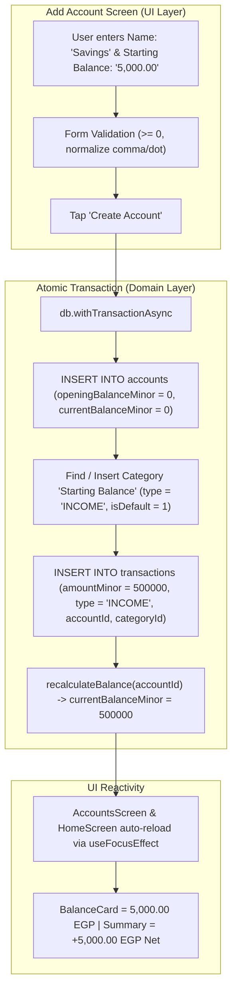

# Implementation Blueprint: Transactional Starting Balance

**Status:** Ready for Implementation  
**Architectural Discipline:** `/feature-architect` × `/frontend-design-master`  
**Target Screens & Services:**
- [`src/services/database/client.ts`](file:///home/malik/my-projects/home_expenses_app/src/services/database/client.ts) (Category seeding)
- [`src/services/database/accounts.ts`](file:///home/malik/my-projects/home_expenses_app/src/services/database/accounts.ts) (Atomic service method)
- [`src/screens/AddEditAccountScreen.tsx`](file:///home/malik/my-projects/home_expenses_app/src/screens/AddEditAccountScreen.tsx) (UI form, validation & live preview)

---

## 1. Problem Statement & Ledger Law

### 1.1 The "Ghost Balance" Anti-Pattern (Root Cause)
In previous versions, accounts stored a raw `openingBalanceMinor` integer directly in the SQLite `accounts` table. If a user entered 5,000 EGP as starting balance, the scalar was stored on the account row without creating a corresponding entry in `transactions`.

This broke the double-entry accounting identity:

$$\text{Total Net Worth} \equiv \sum \text{Income} - \sum \text{Expenses} + \Delta\text{Transfers} \pm \Delta\text{Loans}$$

* **Consequences:**
  - Balance Card showed 5,000 EGP, but Monthly Summary showed `Income: 0 | Spent: 0 | Net: 0`.
  - Statistics and Month History (`getMonthHistory`) had zero awareness of the funds.
  - In commit `6c5e78f`, the balance input was stripped out as a quick-fix, leaving users unable to set starting balances.

### 1.2 The Unified Ledger Law
> **All purchasing power in any account balance MUST originate from an immutable, dated, categorized entry in the unified `transactions` ledger.**

Under this implementation:
1. `accounts.openingBalanceMinor` is permanently kept at `0` for new accounts.
2. If the user specifies a starting balance $> 0$, an atomic `INCOME` transaction is automatically recorded under the system category **`Starting Balance`**.
3. All-time net worth, monthly cash flow, and account balances reconcile with 100% mathematical precision.



---

## 2. Frontend Design & UX Heuristics (`frontend-design-master`)

### 2.1 Token & Layout Discipline
* **Spacing Scale:** Strict mathematical 4px/8px scale (`4, 8, 12, 16, 20, 24, 32px`). No arbitrary offsets (e.g., `13px`, `27px`).
* **Semantic Theme Tokens:** Use `colors.*` from `useTheme()` exclusively (`colors.primary`, `colors.border`, `colors.inputFill`, `colors.textPrimary`, `colors.textSecondary`, `colors.danger`, `colors.success`). Never hardcode hex values.
* **Typography:** Strict hierarchy — H1 (18pt bold), Section Labels (12pt uppercase bold, letter-spacing 0.5), Body (14–16pt). Minimum 16pt input text size to avoid the iOS auto-zoom trap.

### 2.2 Form Ergonomics & Touch Targets
* **Minimum Touch Target:** All interactive controls (type pills, color swatches, icon buttons) meet the **44×44pt** iOS / **48×48dp** Android minimum bounding box with `hitSlop={{ top: 6, bottom: 6, left: 6, right: 6 }}`.
* **Keyboard Ergonomics:**
  - `keyboardType="decimal-pad"`
  - `returnKeyType="done"`
  - Support both `.` and `,` decimal separators (normalized via `.replace(',', '.')`).
  - Never block paste events.
* **Live WYSIWYG Preview Card:**
  - The preview card at the top of [`AddEditAccountScreen.tsx`](file:///home/malik/my-projects/home_expenses_app/src/screens/AddEditAccountScreen.tsx) dynamically updates to show:
    - Selected emoji & accent color
    - Live typed account name
    - Account type badge
    - **Live formatted balance preview** (e.g., `5,000.00 EGP` on new account, or current balance on edit).

### 2.3 Complete State Matrix

| State | Visual Treatment | Interaction / Behavior |
|---|---|---|
| **Default / Initial (New Account)** | Input field pre-filled with empty or `0.00`. Helper text below input explains the automatic deposit. | Numeric keypad opens immediately on tap. |
| **Active Typing** | Live preview card updates amount in real time. | Helper text visible: *"An initial deposit transaction will automatically be recorded."* |
| **Validation Error** | Red border (`colors.danger`), error text below input: *"Starting balance must be 0 or more"*. | Submit button disabled or blocked with inline error highlight. |
| **Submitting / Loading** | `AppButton` shows spinner while maintaining fixed height and width (no layout collapse). | Double-submission prevented via `loading={loading}`. |
| **Edit Mode (Existing Account)** | The starting balance input is replaced by a read-only **Current Balance Badge Card**. | Informs user: *"Current balance is managed through transactions and transfers."* |

---

## 3. Implementation Code Recipes

### Recipe 1: Database Category Seeding ([`src/services/database/client.ts`](file:///home/malik/my-projects/home_expenses_app/src/services/database/client.ts))

Add the default `'Starting Balance'` category to `INCOME_BUILT_IN` and `DEFAULT_INCOME_COLORS`:

```typescript
// in src/services/database/client.ts
const INCOME_BUILT_IN: { name: string; emoji: string; sortOrder: number }[] = [
  { name: 'Salary', emoji: '💼', sortOrder: 0 },
  { name: 'Freelance', emoji: '💻', sortOrder: 1 },
  { name: 'Gift', emoji: '🎁', sortOrder: 2 },
  { name: 'Investment', emoji: '📈', sortOrder: 3 },
  { name: 'Other', emoji: '💰', sortOrder: 4 },
  { name: 'Starting Balance', emoji: '🏁', sortOrder: 5 }, // System initial deposit category
];

const DEFAULT_INCOME_COLORS: Record<string, string> = {
  Salary: '#10B981',
  Freelance: '#3B82F6',
  Gift: '#A855F7',
  Investment: '#F59E0B',
  Other: '#6B7280',
  'Starting Balance': '#059669',
};
```

---

### Recipe 2: Domain Service Method ([`src/services/database/accounts.ts`](file:///home/malik/my-projects/home_expenses_app/src/services/database/accounts.ts))

Update `AddAccountInput` and `addAccount` to atomically insert the starting deposit transaction:

```typescript
// in src/services/database/accounts.ts

export interface AddAccountInput {
  name: string;
  type: AccountType;
  startingBalance?: number; // In standard major units (e.g. 500.00)
  icon?: string | null;
  color?: string | null;
  isDefault?: number;
}

export async function addAccount(input: AddAccountInput): Promise<number> {
  const db = await getDb();
  const now = nowIso();
  const startingMinor = toMinorUnits(input.startingBalance ?? 0);

  let newAccountId = 0;

  await db.withTransactionAsync(async () => {
    // 1. Create the account with 0 opening balance
    const result = await db.runAsync(
      `INSERT INTO accounts
         (name, type, currencyCode, openingBalanceMinor, currentBalanceMinor, icon, color, isPrimary, isArchived, createdAt, updatedAt)
       VALUES (?, ?, 'EGP', 0, 0, ?, ?, 0, 0, ?, ?)`,
      [
        input.name.trim(),
        toDbAccountType(input.type),
        input.icon ?? null,
        input.color ?? null,
        now,
        now,
      ],
    );
    newAccountId = result.lastInsertRowId;

    // 2. If starting balance > 0, atomically insert the initial deposit transaction
    if (startingMinor > 0) {
      let category = await db.getFirstAsync<{ id: number }>(
        "SELECT id FROM categories WHERE type = 'INCOME' AND name = 'Starting Balance' LIMIT 1",
      );

      if (!category) {
        const catRes = await db.runAsync(
          `INSERT INTO categories
             (name, type, icon, color, isDefault, sortOrder, createdAt, updatedAt)
           VALUES ('Starting Balance', 'INCOME', '🏁', '#059669', 1, 5, ?, ?)`,
          [now, now],
        );
        category = { id: catRes.lastInsertRowId };
      }

      await db.runAsync(
        `INSERT INTO transactions
           (accountId, categoryId, type, amountMinor, currencyCode, title, note, transactionDate, createdAt, updatedAt)
         VALUES (?, ?, 'INCOME', ?, 'EGP', ?, ?, ?, ?, ?)`,
        [
          newAccountId,
          category.id,
          startingMinor,
          'Starting Balance',
          `Initial balance for ${input.name.trim()}`,
          now,
          now,
          now,
        ],
      );

      // 3. Recalculate materialized running balance
      await recalculateBalance(newAccountId);
    }
  });

  return newAccountId;
}
```

---

### Recipe 3: Complete UI Screen ([`src/screens/AddEditAccountScreen.tsx`](file:///home/malik/my-projects/home_expenses_app/src/screens/AddEditAccountScreen.tsx))

Replace the screen contents with this accessible, token-compliant component:

```tsx
import React, { useEffect, useState } from 'react';
import {
  View,
  Text,
  ScrollView,
  TouchableOpacity,
  StyleSheet,
  KeyboardAvoidingView,
  Platform,
} from 'react-native';
import { useRouter, useLocalSearchParams } from 'expo-router';
import { Ionicons } from '@expo/vector-icons';
import { useTheme } from '@/theme/ThemeContext';
import { getAccountById, addAccount, updateAccount, getSettings } from '@/services/database';
import { formatCurrency } from '@/services/constants';
import { Account, AccountType } from '@/types';
import { ACCOUNT_TYPE_LABELS, ACCOUNT_TYPE_ICONS } from '@/components/AccountPicker';
import AppInput from '@/components/AppInput';
import AppButton from '@/components/AppButton';
import { useAppDialog } from '@/components/AppDialog';

const PRESET_COLORS = [
  '#10B981', '#3B82F6', '#8B5CF6', '#F59E0B',
  '#EF4444', '#06B6D4', '#EC4899', '#6B7280',
  '#F97316', '#84CC16',
];

const PRESET_ICONS: Record<AccountType, string[]> = {
  cash:         ['💵', '💴', '💶', '💷', '🪙', '💰'],
  bank_account: ['🏦', '💳', '🏧', '📊', '💼', '🏢'],
  e_wallet:     ['📱', '💻', '⚡', '🔗', '📲', '🌐'],
};

const ACCOUNT_TYPES: AccountType[] = ['cash', 'bank_account', 'e_wallet'];

export default function AddEditAccountScreen() {
  const { colors } = useTheme();
  const router = useRouter();
  const { showDialog } = useAppDialog();
  const { accountId } = useLocalSearchParams<{ accountId?: string }>();
  const isEdit = !!accountId;

  const [editAccount, setEditAccount] = useState<Account | null>(null);
  const [currency, setCurrency] = useState('EGP');
  const [name, setName] = useState('');
  const [startingBalance, setStartingBalance] = useState('');
  const [type, setType] = useState<AccountType>('cash');
  const [icon, setIcon] = useState('💵');
  const [color, setColor] = useState(PRESET_COLORS[0]!);

  const [nameError, setNameError] = useState('');
  const [balanceError, setBalanceError] = useState('');
  const [loading, setLoading] = useState(false);

  useEffect(() => {
    getSettings().then((s) => setCurrency(s.currency ?? 'EGP'));
    if (!accountId) return;
    getAccountById(Number(accountId)).then((acc) => {
      if (!acc) return;
      setEditAccount(acc);
      setName(acc.name);
      setType(acc.type);
      setIcon(acc.icon ?? '💵');
      setColor(acc.color ?? PRESET_COLORS[0]!);
    });
  }, [accountId]);

  useEffect(() => {
    if (!isEdit) {
      setIcon(PRESET_ICONS[type][0]!);
    }
  }, [type, isEdit]);

  const parsedBalance = parseFloat(startingBalance.replace(',', '.'));
  const previewBalance = isEdit
    ? (editAccount?.currentBalance ?? 0)
    : (!isNaN(parsedBalance) && parsedBalance > 0 ? parsedBalance : 0);

  const validate = (): boolean => {
    let valid = true;
    if (!name.trim()) {
      setNameError('Account name is required');
      valid = false;
    } else {
      setNameError('');
    }

    if (!isEdit && startingBalance.trim().length > 0) {
      const val = parseFloat(startingBalance.replace(',', '.'));
      if (isNaN(val) || val < 0) {
        setBalanceError('Starting balance must be 0 or more');
        valid = false;
      } else {
        setBalanceError('');
      }
    } else {
      setBalanceError('');
    }

    return valid;
  };

  const save = async () => {
    if (!validate()) return;
    setLoading(true);
    try {
      if (isEdit && editAccount) {
        await updateAccount(editAccount.id, {
          name: name.trim(),
          type,
          currentBalance: editAccount.currentBalance,
          icon,
          color,
        });
      } else {
        const bal = parseFloat(startingBalance.replace(',', '.'));
        await addAccount({
          name: name.trim(),
          type,
          startingBalance: !isNaN(bal) && bal > 0 ? bal : 0,
          icon,
          color,
          isDefault: 0,
        });
      }
      router.back();
    } catch (e: any) {
      const msg = e?.message ?? '';
      if (msg.toLowerCase().includes('unique')) {
        setNameError('An account with this name already exists');
      } else {
        showDialog({
          title: 'Error',
          message: 'Failed to save account. Please try again.',
          icon: '❌',
          type: 'danger',
          buttons: [{ text: 'OK', style: 'default' }],
        });
      }
    } finally {
      setLoading(false);
    }
  };

  return (
    <KeyboardAvoidingView
      style={[styles.screen, { backgroundColor: colors.background }]}
      behavior={Platform.OS === 'ios' ? 'padding' : undefined}
    >
      {/* Header */}
      <View style={[styles.header, { borderBottomColor: colors.border }]}>
        <TouchableOpacity
          onPress={() => router.back()}
          hitSlop={{ top: 12, bottom: 12, left: 12, right: 12 }}
          accessibilityRole="button"
          accessibilityLabel="Go back"
          style={styles.backBtn}
        >
          <Ionicons name="arrow-back" size={24} color={colors.textPrimary} />
        </TouchableOpacity>
        <Text style={[styles.title, { color: colors.textPrimary }]} accessibilityRole="header">
          {isEdit ? 'Edit Account' : 'New Account'}
        </Text>
        <View style={{ width: 44 }} />
      </View>

      <ScrollView
        contentContainerStyle={styles.content}
        showsVerticalScrollIndicator={false}
        keyboardShouldPersistTaps="handled"
      >
        {/* WYSIWYG Live Preview Card */}
        <View style={[styles.preview, { backgroundColor: color + '15', borderColor: color + '35' }]}>
          <View style={[styles.previewIcon, { backgroundColor: color + '25' }]}>
            <Text style={styles.previewEmoji}>{icon}</Text>
          </View>
          <View style={styles.previewInfo}>
            <Text style={[styles.previewName, { color: colors.textPrimary }]} numberOfLines={1}>
              {name.trim() || 'Account Name'}
            </Text>
            <Text style={[styles.previewType, { color: colors.textSecondary }]}>
              {ACCOUNT_TYPE_LABELS[type]}
            </Text>
          </View>
          <View style={styles.previewBalanceCol}>
            <Text style={[styles.previewBalanceLabel, { color: colors.textSecondary }]}>
              {isEdit ? 'Current Balance' : 'Starting Balance'}
            </Text>
            <Text style={[styles.previewBalanceValue, { color: colors.textPrimary }]}>
              {formatCurrency(previewBalance, currency)}
            </Text>
          </View>
        </View>

        {/* Account Name */}
        <AppInput
          label="Account Name"
          value={name}
          onChangeText={(v) => {
            setName(v);
            if (nameError) setNameError('');
          }}
          placeholder="e.g. Main Checking, Safe, Wallet…"
          error={nameError}
          autoCorrect={false}
        />

        {/* Starting Balance (New Account Only) */}
        {!isEdit ? (
          <View style={styles.balanceSection}>
            <AppInput
              label="Starting Balance (Optional)"
              value={startingBalance}
              onChangeText={(v) => {
                setStartingBalance(v);
                if (balanceError) setBalanceError('');
              }}
              placeholder="0.00"
              keyboardType="decimal-pad"
              error={balanceError}
            />
            <Text style={[styles.fieldHelper, { color: colors.textSecondary }]}>
              An initial deposit transaction will automatically be recorded under "Starting Balance".
            </Text>
          </View>
        ) : (
          <View style={[styles.balanceCard, { backgroundColor: colors.card, borderColor: colors.border }]}>
            <View style={styles.balanceCardHeader}>
              <Ionicons name="information-circle-outline" size={18} color={colors.primary} />
              <Text style={[styles.balanceCardTitle, { color: colors.textPrimary }]}>
                Live Account Balance
              </Text>
            </View>
            <Text style={[styles.balanceCardAmount, { color: colors.textPrimary }]}>
              {formatCurrency(editAccount?.currentBalance ?? 0, currency)}
            </Text>
            <Text style={[styles.balanceCardNote, { color: colors.textSecondary }]}>
              Account balances are maintained automatically via transactions and transfers.
            </Text>
          </View>
        )}

        {/* Type selector */}
        <Text style={[styles.sectionLabel, { color: colors.textSecondary }]}>ACCOUNT TYPE</Text>
        <View style={styles.typeRow}>
          {ACCOUNT_TYPES.map((t) => {
            const selected = type === t;
            return (
              <TouchableOpacity
                key={t}
                style={[
                  styles.typePill,
                  {
                    backgroundColor: selected ? colors.primary + '18' : colors.inputFill,
                    borderColor: selected ? colors.primary : colors.border,
                  },
                ]}
                onPress={() => setType(t)}
                activeOpacity={0.75}
                accessibilityRole="button"
                accessibilityState={{ selected }}
                accessibilityLabel={`${ACCOUNT_TYPE_LABELS[t]} account type`}
              >
                <Ionicons
                  name={ACCOUNT_TYPE_ICONS[t]}
                  size={16}
                  color={selected ? colors.primary : colors.textSecondary}
                />
                <Text
                  style={[
                    styles.typePillLabel,
                    {
                      color: selected ? colors.primary : colors.textPrimary,
                      fontWeight: selected ? '700' : '500',
                    },
                  ]}
                >
                  {ACCOUNT_TYPE_LABELS[t]}
                </Text>
              </TouchableOpacity>
            );
          })}
        </View>

        {/* Icon selector */}
        <Text style={[styles.sectionLabel, { color: colors.textSecondary }]}>ICON</Text>
        <View style={styles.iconGrid}>
          {PRESET_ICONS[type].map((em) => {
            const selected = icon === em;
            return (
              <TouchableOpacity
                key={em}
                style={[
                  styles.iconOption,
                  {
                    backgroundColor: selected ? color + '25' : colors.inputFill,
                    borderColor: selected ? color : colors.border,
                  },
                ]}
                onPress={() => setIcon(em)}
                activeOpacity={0.75}
                hitSlop={{ top: 4, bottom: 4, left: 4, right: 4 }}
                accessibilityRole="button"
                accessibilityLabel={`Select icon ${em}`}
              >
                <Text style={styles.iconEmoji}>{em}</Text>
              </TouchableOpacity>
            );
          })}
        </View>

        {/* Color selector */}
        <Text style={[styles.sectionLabel, { color: colors.textSecondary }]}>COLOR THEME</Text>
        <View
          style={styles.colorGrid}
          accessibilityRole="radiogroup"
          accessibilityLabel="Account color palette"
        >
          {PRESET_COLORS.map((c) => {
            const isSelected = color === c;
            return (
              <TouchableOpacity
                key={c}
                style={[
                  styles.colorDot,
                  { backgroundColor: c },
                  isSelected && { borderColor: colors.textPrimary, borderWidth: 2.5 },
                ]}
                onPress={() => setColor(c)}
                activeOpacity={0.8}
                hitSlop={{ top: 6, bottom: 6, left: 6, right: 6 }}
                accessibilityRole="radio"
                accessibilityState={{ selected: isSelected }}
                accessibilityLabel={`Color theme ${c}`}
              >
                {isSelected && <Ionicons name="checkmark" size={18} color="#FFFFFF" />}
              </TouchableOpacity>
            );
          })}
        </View>

        {/* Action Button */}
        <View style={styles.buttonWrap}>
          <AppButton
            label={isEdit ? 'Update Account' : 'Create Account'}
            onPress={save}
            loading={loading}
          />
        </View>

        <View style={{ height: 32 }} />
      </ScrollView>
    </KeyboardAvoidingView>
  );
}

const styles = StyleSheet.create({
  screen: { flex: 1 },
  header: {
    flexDirection: 'row',
    alignItems: 'center',
    justifyContent: 'space-between',
    paddingHorizontal: 16,
    paddingVertical: 12,
    borderBottomWidth: 1,
  },
  backBtn: {
    width: 44,
    height: 44,
    alignItems: 'center',
    justifyContent: 'center',
  },
  title: { fontSize: 18, fontWeight: '700' },
  content: { padding: 20 },

  // Live Preview Card
  preview: {
    flexDirection: 'row',
    alignItems: 'center',
    padding: 16,
    borderRadius: 16,
    borderWidth: 1,
    marginBottom: 20,
    gap: 12,
  },
  previewIcon: {
    width: 48,
    height: 48,
    borderRadius: 12,
    alignItems: 'center',
    justifyContent: 'center',
  },
  previewEmoji: { fontSize: 24 },
  previewInfo: { flex: 1 },
  previewName: { fontSize: 16, fontWeight: '700', marginBottom: 2 },
  previewType: { fontSize: 12, fontWeight: '500' },
  previewBalanceCol: { alignItems: 'flex-end' },
  previewBalanceLabel: { fontSize: 10, fontWeight: '600', textTransform: 'uppercase', marginBottom: 2 },
  previewBalanceValue: { fontSize: 14, fontWeight: '700' },

  // Starting balance section
  balanceSection: { marginBottom: 16 },
  fieldHelper: {
    fontSize: 12,
    lineHeight: 16,
    marginTop: 6,
    marginHorizontal: 4,
  },

  // Read-only Balance Card in Edit Mode
  balanceCard: {
    borderRadius: 12,
    borderWidth: 1,
    padding: 16,
    marginBottom: 20,
  },
  balanceCardHeader: {
    flexDirection: 'row',
    alignItems: 'center',
    gap: 6,
    marginBottom: 6,
  },
  balanceCardTitle: { fontSize: 12, fontWeight: '700', textTransform: 'uppercase' },
  balanceCardAmount: { fontSize: 24, fontWeight: '800', marginBottom: 6 },
  balanceCardNote: { fontSize: 12, lineHeight: 16 },

  // Form Section Headings
  sectionLabel: {
    fontSize: 11,
    fontWeight: '700',
    letterSpacing: 0.8,
    marginBottom: 8,
    marginTop: 8,
  },

  // Account Type Pills
  typeRow: { flexDirection: 'row', gap: 8, marginBottom: 16 },
  typePill: {
    flex: 1,
    minHeight: 44,
    flexDirection: 'row',
    alignItems: 'center',
    justifyContent: 'center',
    gap: 6,
    paddingHorizontal: 8,
    paddingVertical: 10,
    borderRadius: 10,
    borderWidth: 1,
  },
  typePillLabel: { fontSize: 12 },

  // Icon Grid
  iconGrid: {
    flexDirection: 'row',
    flexWrap: 'wrap',
    gap: 10,
    marginBottom: 16,
  },
  iconOption: {
    width: 46,
    height: 46,
    borderRadius: 12,
    alignItems: 'center',
    justifyContent: 'center',
    borderWidth: 1,
  },
  iconEmoji: { fontSize: 22 },

  // Color Grid
  colorGrid: {
    flexDirection: 'row',
    flexWrap: 'wrap',
    gap: 12,
    marginBottom: 24,
  },
  colorDot: {
    width: 36,
    height: 36,
    borderRadius: 18,
    alignItems: 'center',
    justifyContent: 'center',
  },

  buttonWrap: { marginTop: 8 },
});
```

---

## 4. Implementation Steps (Execution Order)

1. **Step 1 — Update Category Seed Data:**
   - In [`src/services/database/client.ts`](file:///home/malik/my-projects/home_expenses_app/src/services/database/client.ts), add `'Starting Balance'` to `INCOME_BUILT_IN` and `DEFAULT_INCOME_COLORS`.
2. **Step 2 — Implement Atomic `addAccount`:**
   - In [`src/services/database/accounts.ts`](file:///home/malik/my-projects/home_expenses_app/src/services/database/accounts.ts), wrap `addAccount` in `db.withTransactionAsync` to insert the initial deposit transaction under category `'Starting Balance'`.
3. **Step 3 — Update Screen UI & Validation:**
   - In [`src/screens/AddEditAccountScreen.tsx`](file:///home/malik/my-projects/home_expenses_app/src/screens/AddEditAccountScreen.tsx), replace the form with the WYSIWYG preview card and starting balance field.
4. **Step 4 — Lint & Verification:**
   - Run `npm run lint`.
   - Verify creation with `0.00` (no transaction created).
   - Verify creation with `5,000.00` (deposit transaction created, account card shows `5,000.00 EGP`, monthly net shows `+5,000.00 EGP`).
